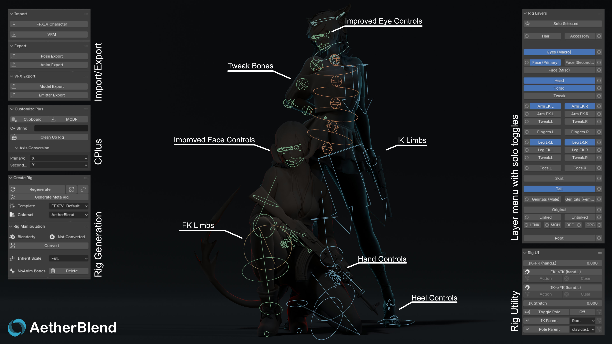
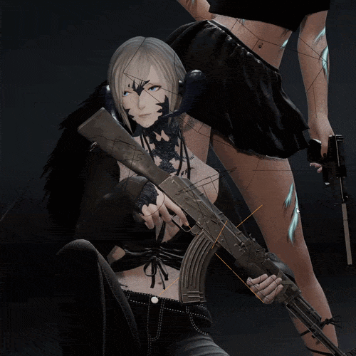
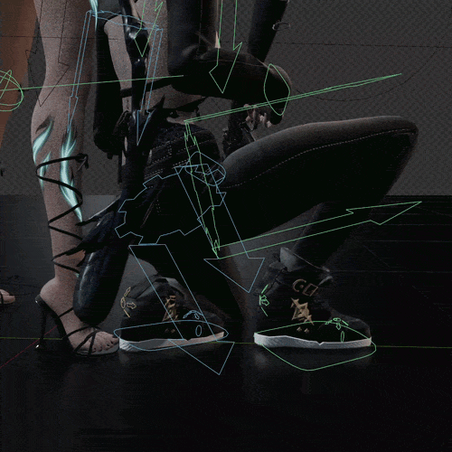
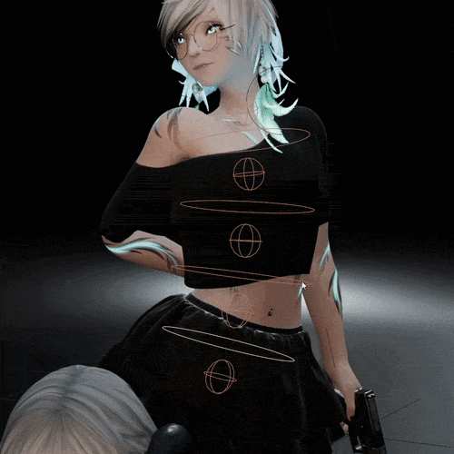
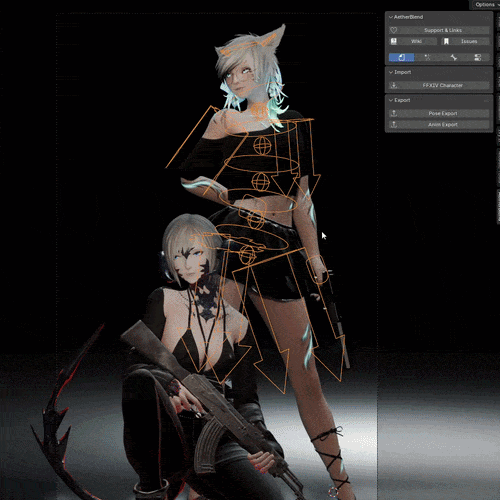

 

  &nbsp;&nbsp;
  

    
    
    

&nbsp;

AetherBlend is a toolkit for FFXIV modding and creative work in Blender, built with game compatibility in mind.
Currently in beta; tools and workflows are still being refined.

  

&nbsp;

  &nbsp;&nbsp;&nbsp;
  &nbsp;&nbsp;&nbsp;
  

&nbsp;

## About AetherBlend

AetherBlend started as an IK rig generator and has grown into a broader toolkit for working with FFXIV in Blender. It supports both game modding and creative work in Blender, with game compatibility at the core of its design.

The add-on is still in beta, and its tools and workflows are being refined.

## A rig built around your character

AetherBlend adapts Rigify to FFXIV's armature, adding controls and generating a metarig fitted to your character's proportions and custom scaling.

The original game bones are linked to the control rig rather than replaced, preserving game compatibility while giving you Blender controls for posing and animation.

<table>
  <tr>
    <th align="center">IK controls</th>
    <th align="center">Heel controls</th>
    <th align="center">Spline controls</th>
  </tr>
  <tr>
    <td width="33%" align="center"></td>
    <td width="33%" align="center"></td>
    <td width="33%" align="center"></td>
  </tr>
  <tr>
    <td align="center" valign="middle">
      
    </td>
    <td colspan="2" valign="middle">
      <h3>From Blender to the game</h3>
      
Game compatibility is central to AetherBlend, including pose export for GPose and animation export for modding.

      
The goal is to keep poses and motion consistent between Blender and FFXIV.

    </td>
  </tr>
</table>

## Road to 1.0

The feature scope for 1.0. Available tools are still being refined during beta.

### Available in beta

- [x] Character import
- [x] C+ application
- [x] Full rig generation
- [x] GPose export
- [x] Animation export
- [x] VFX toolkits

### Still to come

- [ ] Animation and GPose import
- [ ] Action Library
- [ ] C+ export
- [ ] AetherBridge: seamless actor streaming between FFXIV and Blender

&nbsp;

## Acknowledgements
- A special thank you to [Oats](https://github.com/ExplosiveOats), co-developer, for the care and dedication she brings to AetherBlend and its community. I'm deeply grateful she joined the team and that we get to build this project together.

- [PassiveModding](https://github.com/PassiveModding), creator of [Meddle](https://github.com/PassiveModding/Meddle) and [Meddle Tools](https://github.com/PassiveModding/MeddleTools), for tools that helped inspire AetherBlend.

- [sleepybunny](https://github.com/sleepybnuuy), whose [bustomize](https://github.com/sleepybnuuy/bustomize) provided the foundation for AetherBlend's C+ application.

- The AetherBlend, [Mektools](https://github.com/MekuMaki/Mektools) and [Mythtools](https://github.com/ShinoMythmaker/Myth-Tools) communities, and my Patreon supporters, for their continued support.

---
&nbsp; 
